# WSBroker Display Client (`pkg/displayclient`)

`displayclient` provides a high-level, idiomatic Go client library for remotely controlling WSBroker display instances over encrypted WebSocket connections. It abstracts low-level WebSocket protocol envelopes, correlation token matching, and payload serialization into type-safe synchronous (request-reply) and asynchronous (fire-and-forget) Go APIs.

---

## Features

- **Exclusively WebSocket-Based Communication**: Communicates entirely over `wsbrokerclient` without requiring HTTP/REST endpoints.
- **Synchronous Request-Reply Correlation**:
  - Automatically generates cryptographically unique correlation tokens.
  - Matches response events (`NavigateResponse`, `URLResponse`, `StatusResponse`, and binary `TypeFile` screenshot payloads) to waiting goroutines.
  - Thread-safe waiter registry with automatic timeout bounds and context cancellation.
- **Asynchronous / Fire-and-Forget Senders**:
  - Send commands without blocking or waiting for acknowledgments.
  - Optional custom correlation token propagation.
- **Display Remote Control Operations**:
  - **Navigation**: Navigate target display browsers to URLs with optional CSS selector readiness synchronization (`Navigate`).
  - **URL Query**: Retrieve currently active browser URL (`GetURL`).
  - **Resolution-Bounded Screenshots**: Fetch downscaled viewport captures (JPEG/PNG) returned as binary byte buffers (`GetScreenshot`).
  - **Live Telemetry & Status**: Query runtime health, browser state, NTP synchronization, and connection details (`GetStatus`).
- **Clean Architecture & Extensibility**:
  - Decoupled via `BrokerClient` interface for direct integration with `*rawclient.Client` and effortless test mocking.
  - Functional options (`WithTimeout`, `WithDefaultScreenshotOptions`).
  - Idempotent and safe resource teardown (`Close`).

---

## Architecture

```mermaid
graph LR
    App["Application / Controller"] -->|Invoke Navigate / GetURL / Screenshot / GetStatus| Client["pkg/displayclient (Client)"]
    Client -->|Generate Token & Send Event| Raw["wsbrokerclient (*rawclient.Client)"]
    Raw -->|WebSocket Encrypted Frame| Broker["WSBroker Server"]
    Broker -->|Route Command to Display| Display["wsbrokerdisplay (pkg/display)"]
    Display -->|Execute CDP Action| Browser["pkg/browser (Chromium)"]
    Browser -->|DOM Readiness / Image / URL| Display
    Display -->|Response Event with Matching Token| Broker
    Broker -->|Deliver Response Frame| Raw
    Raw -->|OnEvent Listener Callback| Client
    Client -->|Resolve Correlated Waiter Channel| App
```



---

## Installation & Import

```go
import (
    "github.com/je4/wsbrokerdisplayclient/pkg/displayclient"
    rawclient "github.com/je4/wsbrokerclient/pkg/client"
)
```

---

## Core Types and Data Models

### Command Constants
```go
const (
    EventNavigate           = "display:navigate"
    EventNavigateResponse   = "display:navigate_response"
    EventGetURL             = "display:geturl"
    EventGetURLResponse     = "display:geturl_response"
    EventGetScreenshot      = "display:getscreenshot"
    EventScreenshotResponse = "display:getscreenshot_response"
    EventGetStatus          = "display:getstatus"
    EventGetStatusResponse  = "display:getstatus_response"
)
```

### Response Structures
- `NavigateResponse`: Contains operation `Status` ("ok" or "error"), target `URL`, and optional `Error` message.
- `URLResponse`: Contains active browser `URL` and optional `Error` message.
- `ScreenshotResponse`: Returned on screenshot errors.
- `ScreenshotResult`: Contains `Filename`, `MimeType` (e.g. `"image/jpeg"`), and raw binary `Data []byte`.
- `StatusResponse`: Encapsulates `rest.DashboardData` with system, NTP, browser, and network telemetry.

---

## API Summary

### Constructor & Lifecycle
- `New(raw BrokerClient, logger zLogger.ZLogger, opts ...Option) (*Client, error)`
- `Connect(ctx context.Context) error`: Connects to WSBroker asynchronously.
- `ConnectSync(ctx context.Context) error`: Connects to WSBroker synchronously.
- `Close() error`: Gracefully closes listeners, cancels active waiters, and closes transport.
- `ClientName() string`: Returns the local client identifier.
- `RawClient() BrokerClient`: Exposes the underlying broker client instance.

### Synchronous Remote Control Methods
- `Navigate(ctx context.Context, target string, targetURL string, waitSelector ...string) (*NavigateResponse, error)`
- `GetURL(ctx context.Context, target string) (string, error)`
- `GetScreenshot(ctx context.Context, target string, opts ...ScreenshotOptions) (*ScreenshotResult, error)`
- `GetStatus(ctx context.Context, target string) (*rest.DashboardData, error)`

### Asynchronous Remote Control Methods
- `SendNavigate(ctx context.Context, target string, targetURL string, waitSelector string, token ...string) error`
- `SendGetURL(ctx context.Context, target string, token ...string) error`
- `SendGetScreenshot(ctx context.Context, target string, format string, quality int, token ...string) error`
- `SendGetStatus(ctx context.Context, target string, token ...string) error`

---

## Usage Example

```go
package main

import (
	"context"
	"fmt"
	"log"
	"os"
	"time"

	"github.com/je4/utils/v2/pkg/zLogger"
	rawclient "github.com/je4/wsbrokerclient/pkg/client"
	"github.com/je4/wsbrokerdisplayclient/pkg/displayclient"
	"github.com/rs/zerolog"
)

func main() {
	// 1. Initialize Logger
	output := zerolog.ConsoleWriter{Out: os.Stdout, TimeFormat: time.RFC3339}
	loggerZero := zerolog.New(output).With().Timestamp().Logger()
	var logger zLogger.ZLogger = &loggerZero

	// 2. Initialize Underlying WSBroker Transport
	rawCfg := rawclient.DefaultConfig()
	rawClient, err := rawclient.New(rawCfg,
		rawclient.WithEndpoint("wss://broker.example.com/ws"),
		rawclient.WithClientName("controller-01"),
		rawclient.WithAutoReconnect(true),
		rawclient.WithLogger(logger),
	)
	if err != nil {
		log.Fatalf("failed to create raw client: %v", err)
	}

	// 3. Initialize Display Client
	client, err := displayclient.New(rawClient, logger,
		displayclient.WithTimeout(15*time.Second),
		displayclient.WithDefaultScreenshotOptions(displayclient.ScreenshotOptions{
			Format:  "jpeg",
			Quality: 85,
		}),
	)
	if err != nil {
		log.Fatalf("failed to create display client: %v", err)
	}
	defer client.Close()

	// 4. Connect to WSBroker
	ctx := context.Background()
	if err := client.ConnectSync(ctx); err != nil {
		log.Fatalf("failed to connect to wsbroker: %v", err)
	}

	targetDisplay := "display-reception"

	// 5. Navigate to URL and wait for DOM element readiness
	navResp, err := client.Navigate(ctx, targetDisplay, "https://dashboard.example.com", "#ready-indicator")
	if err != nil {
		log.Printf("navigation error: %v", err)
	} else {
		fmt.Printf("Navigated target to %s (status: %s)\n", navResp.URL, navResp.Status)
	}

	// 6. Query Active Location URL
	activeURL, err := client.GetURL(ctx, targetDisplay)
	if err != nil {
		log.Printf("geturl error: %v", err)
	} else {
		fmt.Printf("Active display URL: %s\n", activeURL)
	}

	// 7. Capture Resolution-Bounded Viewport Screenshot (max 800x600)
	screenshot, err := client.GetScreenshot(ctx, targetDisplay, displayclient.ScreenshotOptions{
		Format:  "jpeg",
		Quality: 85,
	})
	if err != nil {
		log.Printf("screenshot error: %v", err)
	} else {
		fmt.Printf("Received screenshot: %s (%s, %d bytes)\n",
			screenshot.Filename, screenshot.MimeType, len(screenshot.Data))
		_ = os.WriteFile("preview.jpg", screenshot.Data, 0644)
	}

	// 8. Query Live Telemetry and Status
	status, err := client.GetStatus(ctx, targetDisplay)
	if err != nil {
		log.Printf("getstatus error: %v", err)
	} else {
		fmt.Printf("Display Status: Host=%s, Uptime=%s, NTP InSync=%v\n",
			status.Hostname, status.Uptime, status.NTP.InSync)
	}
}
```
